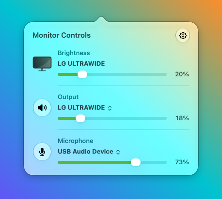
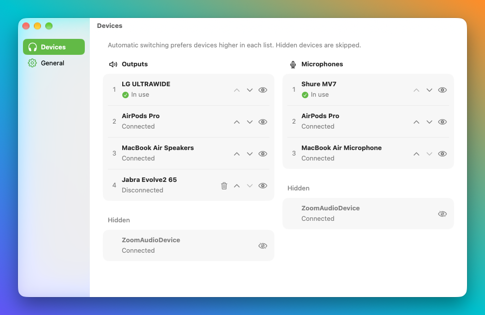
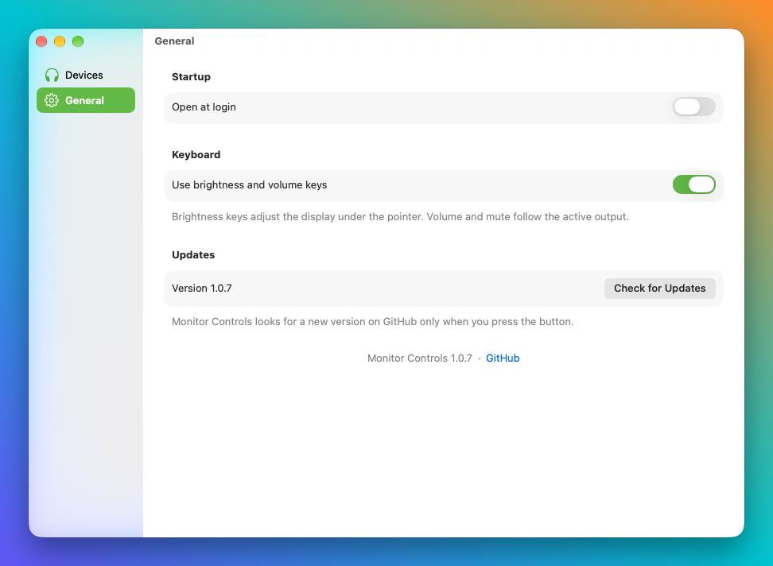

# Monitor Controls

A macOS menu-bar app for external monitor brightness, speaker volume and the microphone. It needs a Mac with Apple silicon and macOS 14 or later.

<p align="center">
  
</p>

## Install

1. Download [MonitorControls.zip](https://github.com/ars-3n/Monitor-Controls/releases/latest/download/MonitorControls.zip) and unzip it.
2. Drag **Monitor Controls.app** into Applications and open it.
3. Click the monitor icon with three sound-level bars in the menu bar. Right-click it to quit.

Coming from Desk Controls? Quit it and move it out of Applications first. Your device preferences carry over.

## The panel

- Each external monitor has its own brightness slider. The app sets brightness over DDC/CI as you drag.
- Volume and mute follow the current sound output. Monitor speakers are set over DDC/CI. AirPods and other outputs use the macOS volume.
- The microphone row sets input gain and mute when the device supports them.
- The output and microphone names are menus for switching devices.

## Settings

<p align="center">
  
</p>

**Devices** lists outputs and microphones side by side. Automatic switching prefers devices higher in each list. The arrows change the order. The eye hides a device from the panel and from automatic switching. A disconnected device has a trash button that removes it from the list. Audio Priority Bar users can import their saved order once.

<p align="center">
  
</p>

**General** has these settings:

- Open at login.
- Use the Apple brightness and volume keys. Brightness keys act on the display under the pointer. A small indicator under the menu-bar icon shows the new brightness. This needs access in **System Settings → Privacy & Security → Accessibility**. If you also run MonitorControl, turn off its key handling so one app handles each keypress.
- Check for Updates. The app looks for a newer release on GitHub only when you press the button. **Install and Relaunch** then replaces the app with the new version.

When a monitor's speakers are the active output, General also shows which display the volume slider controls. Change it when two displays share a name or the output and display names differ.

## Limits

- Brightness and monitor volume depend on DDC/CI. Some docks do not carry it, and some monitors have it switched off in their own menu. The panel says which controls are unavailable.
- Releases have no Developer ID signature or notarization.
- An update installs itself only if it is signed with the same certificate as the running copy. An ad-hoc build opens the release page for a manual download.

## Build

Use Xcode with Swift 6.2 or later.

```sh
swift test
./scripts/build.sh
```

`build.sh` writes an Apple silicon app to `dist/MonitorControls.zip`, signed ad hoc. macOS ties Accessibility access to the signature, so an ad-hoc build loses that access each time it replaces an older one. To keep it, sign with a certificate from your keychain:

```sh
CODESIGN_IDENTITY="My Signing Certificate" ./scripts/build.sh
```

GitHub Actions tests each commit on `main` and publishes the ZIP as a release. It signs with a certificate when the repository has the secrets `SIGNING_CERTIFICATE_P12` (a base64-encoded `.p12` with its private key) and `SIGNING_CERTIFICATE_PASSWORD`. A self-signed certificate keeps Accessibility access across updates as long as every release uses the same one.

With exactly one LG ULTRAWIDE connected, a hardware test makes small changes to brightness, volume and mute, then restores the originals:

```sh
DESK_CONTROLS_TEST_LG=1 swift test --filter LGHardwareTests
```

## Source

AppKit runs the menu bar and SwiftUI draws the panel and Settings. `AudioRouting` watches Core Audio devices, `DisplayHardware` talks to displays, `DeskPolicy` decides speaker pairing and media-key ownership, `AppUpdate` installs releases, and `DisplayBridge` is a small C layer over the macOS display transports.

Monitor Controls includes work from Audio Priority Bar and MonitorControl. See [LICENSE](LICENSE) and the [origin and license notices](Licenses/Origins.txt).
