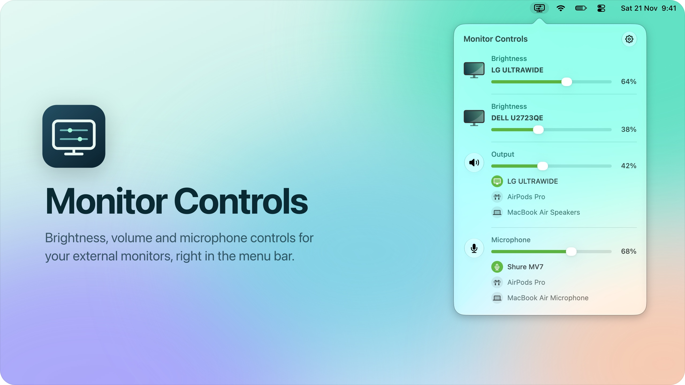
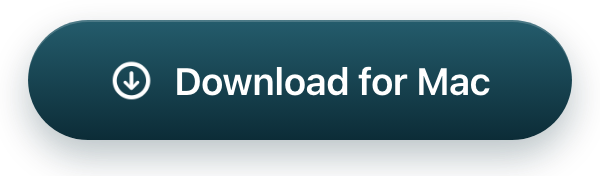
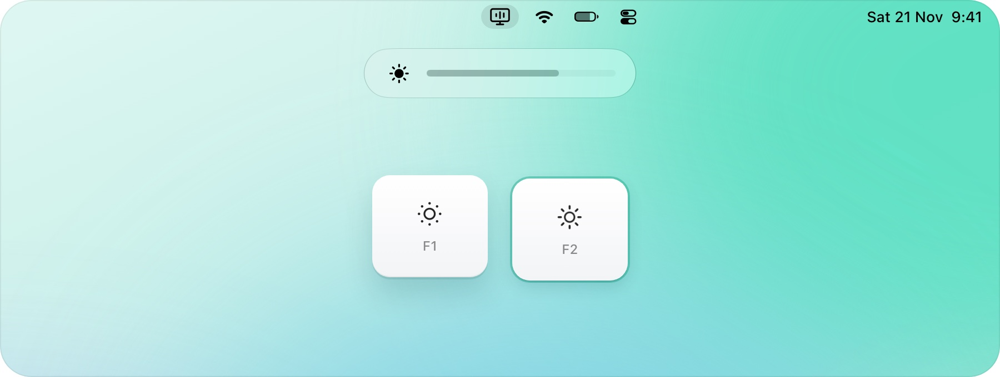
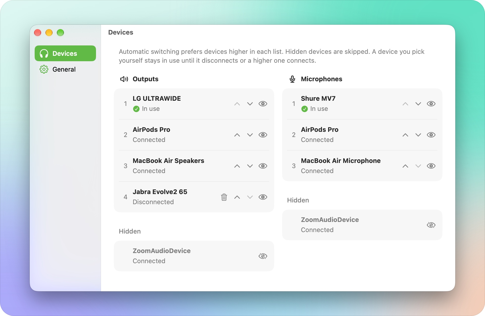

<p align="center">
  <picture>
    <source media="(prefers-color-scheme: dark)" srcset=".github/readme/hero-dark.jpg">
    
  </picture>
</p>

<p align="center">
  <a href="https://github.com/ars-3n/Monitor-Controls/releases/latest/download/MonitorControls.zip">
    <picture>
      <source media="(prefers-color-scheme: dark)" srcset=".github/readme/download-dark.png">
      
    </picture>
  </a>
</p>

<p align="center"><sub>Free and open source&nbsp;&nbsp;·&nbsp;&nbsp;macOS 14 or later&nbsp;&nbsp;·&nbsp;&nbsp;Apple silicon</sub></p>

<br>

macOS can't set the brightness or the speaker volume of most external monitors. Monitor Controls can. It talks to the display over DDC/CI, the control link that runs through the display cable, and puts the controls in a small panel in the menu bar. It also keeps sound and the microphone on the devices you rank highest as you plug things in and out. The menu-bar icon is a small monitor with two sliders, and its knobs sit at the current brightness and volume.

### A brightness slider for each monitor

Every external monitor gets its own slider, and the display changes while you drag. The little monitor next to the slider gets darker and lighter with it.

### The brightness keys work on your monitor

Turn on **Brightness and volume keys** in Settings and the keys on your Mac's keyboard control external monitors too. Brightness keys change the display under the pointer, and a small indicator under the menu-bar icon shows the new level. Volume and mute follow the active output.

<p align="center">
  <picture>
    <source media="(prefers-color-scheme: dark)" srcset=".github/readme/keys-dark.jpg">
    
  </picture>
</p>

### Volume for any output, gain for any microphone

The output slider follows whatever is playing sound. Monitor speakers are set over DDC/CI. Any other output, such as AirPods, uses the macOS volume. The microphone row sets input gain and mute when the device supports them. A mute button turns red while its device is muted, and the volume slider in the menu-bar icon dims. Each row lists your three highest-ranked devices, so switching is one click.

### Sound goes where you want it

Put your outputs and microphones in order in Settings. When a device higher in the list connects, Monitor Controls switches to it, and when it disconnects, the next one takes over. A device you pick yourself stays in use until it disconnects or a higher one connects.

<p align="center">
  <picture>
    <source media="(prefers-color-scheme: dark)" srcset=".github/readme/devices-dark.jpg">
    
  </picture>
</p>

Until you change the order, devices you connect come first, then the Mac's own speakers and microphone, then devices created by apps. The eye button hides a device you never want, such as the virtual one a meeting app installs, from the panel and from automatic switching. Disconnected devices get a trash button. Audio Priority Bar users can import their saved order once.

### Alerts and the screenshot sound follow the output

macOS plays sound effects on a device of their own, and it can leave them on the MacBook speakers after you switch to a monitor. Monitor Controls moves them to the output in use each time either one changes. For anything that still plays on the Mac's speakers, point at their row in the panel while another output is in use and a mute button appears. It stays visible, in red, while the speakers are muted.

### Updates from inside the app

**Check for Updates** in Settings looks for a newer release on GitHub only when you press it. **Install and Relaunch** then swaps in the new version.

## Install

1. Download [MonitorControls.zip](https://github.com/ars-3n/Monitor-Controls/releases/latest/download/MonitorControls.zip) and unzip it.
2. Move **Monitor Controls.app** to Applications and open it.
3. Click the monitor icon in the menu bar. Right-click it for Settings and Quit.

> [!NOTE]
> Releases aren't notarized, so the first time you open the app macOS says it can't verify it. Close the message, go to **System Settings → Privacy & Security**, and click **Open Anyway** next to the line about Monitor Controls.

Coming from Desk Controls? Quit it and move it out of Applications first. Your device preferences carry over.

## Good to know

- Brightness and monitor volume depend on DDC/CI. Some docks and adapters don't pass it through, and some monitors have it switched off in their own menu. The panel says which controls are unavailable.
- The keys need access in **System Settings → Privacy & Security → Accessibility**. If you also run MonitorControl, turn off its key handling so one app handles each keypress.
- When a monitor's speakers are the active output, Settings → General shows which display the volume slider controls. Change it when two displays share a name or the output and display names differ.
- While Monitor Controls runs, sound effects always play on the selected output. A different device chosen under **System Settings → Sound → Play sound effects through** is moved back.
- Releases have no Developer ID signature or notarization. An update installs itself only if it is signed with the same certificate as the running copy. An ad-hoc build opens the release page for a manual download.

<details>
<summary><b>Build from source</b></summary>

<br>

Use Xcode with Swift 6.2 or later.

```sh
swift test
./scripts/build.sh
```

`build.sh` writes an Apple silicon app to `dist/MonitorControls.zip`, signed ad hoc. macOS ties Accessibility access to the signature, so an ad-hoc build loses that access each time it replaces an older one. To keep it, sign with a certificate from your keychain:

```sh
CODESIGN_IDENTITY="My Signing Certificate" ./scripts/build.sh
```

GitHub Actions tests each push to `main` and publishes a ZIP of its last commit as a release. It signs with a certificate when the repository has the secrets `SIGNING_CERTIFICATE_P12` (a base64-encoded `.p12` with its private key) and `SIGNING_CERTIFICATE_PASSWORD`. A self-signed certificate keeps Accessibility access across updates as long as every release uses the same one.

With exactly one LG ULTRAWIDE connected, a hardware test makes small changes to brightness, volume and mute, then restores the originals:

```sh
DESK_CONTROLS_TEST_LG=1 swift test --filter LGHardwareTests
```

AppKit runs the menu bar and SwiftUI draws the panel and Settings. `AudioRouting` watches Core Audio devices, `DisplayHardware` talks to displays, `DeskPolicy` decides speaker pairing and media-key ownership, `AppUpdate` installs releases, and `DisplayBridge` is a small C layer over the macOS display transports.

</details>

## License

Monitor Controls is free software under the [GPL-3.0](LICENSE). It includes work from Audio Priority Bar and MonitorControl; see the [origin and license notices](Licenses/Origins.txt).
